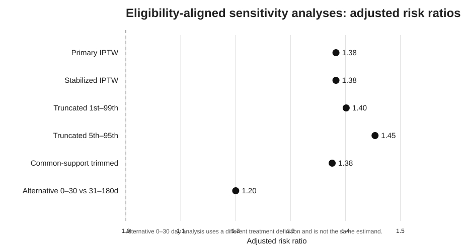
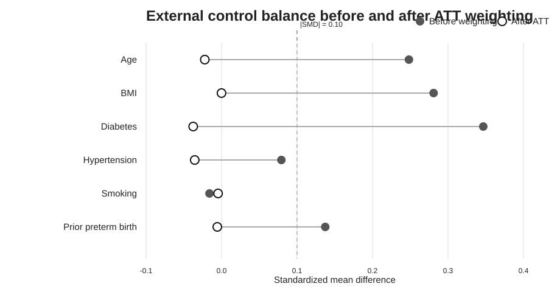
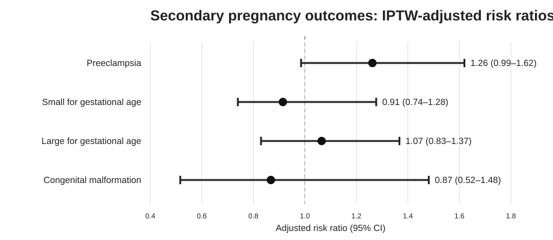
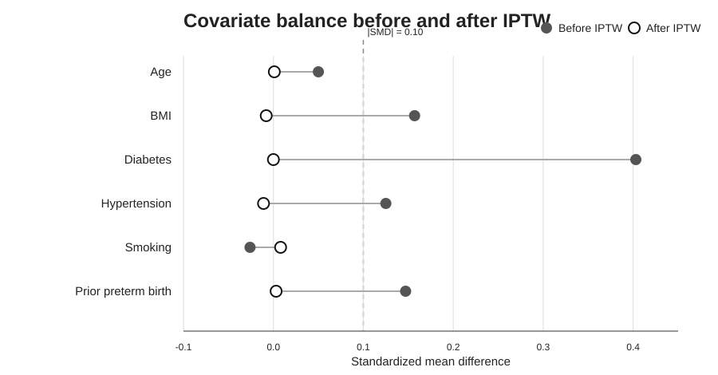
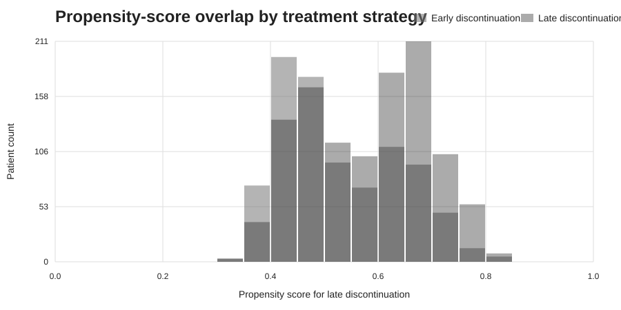
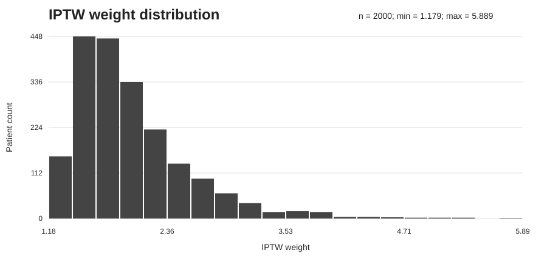
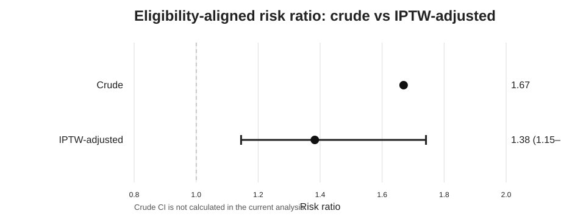

# GLP-1 Target Trial Emulation

**Portfolio baseline: v1.0.0**

A reproducible real-world evidence project demonstrating how a hypothetical target trial can be emulated using synthetic longitudinal healthcare data.

The project focuses on causal inference, propensity-score weighting, cohort comparability, and HTA-oriented evidence generation, with methodological links to External Control Arms and OMOP/EHDS-compatible real-world data workflows.

---

## Research Question

Among individuals exposed to GLP-1 receptor agonists before pregnancy, what is the effect of early versus late preconception discontinuation on the risk of preterm birth?

---

## Target Trial Framework

The hypothetical target trial defines:

- Population: pregnancies with preconception GLP-1RA exposure
- Eligibility: age 18–45 years, documented pregnancy, GLP-1RA exposure within 180 days before conception
- Strategy A: early discontinuation, 61–180 days before conception
- Strategy B: late discontinuation, 0–60 days before conception
- Time zero: estimated date of conception
- Primary outcome: preterm birth
- Follow-up: conception to end of pregnancy
- Primary estimands: risk difference and risk ratio

The complete protocol is available in:

protocol/target_trial_protocol.md

---

## Data

This project uses a synthetic source cohort of 2,000 patients.

The target-trial protocol specifies age 18–45 years. After enforcing this criterion, the canonical primary analysis includes 1,987 eligible records. The 13 ineligible source records are retained in the raw synthetic dataset and documented in an eligibility audit rather than silently removed.

Baseline variables include:

- Age
- BMI
- Diabetes
- Hypertension
- Smoking
- Prior preterm birth

Treatment assignment and outcomes were generated with deliberate confounding so that causal-adjustment methods could be demonstrated.

No real patient data are used.

The synthetic dataset is available in:

data/synthetic_glp1_pregnancy.csv

---

## Causal Inference Workflow

The analysis follows this sequence:

1. Define the hypothetical target trial
2. Generate synthetic longitudinal real-world data
3. Define treatment strategies
4. Assess baseline imbalance
5. Estimate propensity scores
6. Calculate inverse probability of treatment weights (IPTW)
7. Reassess covariate balance
8. Estimate weighted treatment effects
9. Quantify uncertainty using bootstrap confidence intervals
10. Present results in an HTA-oriented format

---

## Propensity Score and IPTW

A logistic regression model estimates each patient's probability of late discontinuation based on baseline characteristics.

Inverse probability of treatment weighting is then used to construct a weighted pseudo-population in which measured baseline characteristics are more comparable between treatment groups.

Covariate balance is assessed using standardized mean differences (SMD).

A commonly used balance threshold is:

|SMD| < 0.10

---

## Balance Results

Before IPTW, important baseline imbalances were present in the eligibility-aligned cohort.

Examples:

- Diabetes: SMD = 0.403
- BMI: SMD = 0.154
- Hypertension: SMD = 0.128
- Prior preterm birth: SMD = 0.152

After IPTW, all measured baseline covariates had absolute SMD values below 0.012.

This demonstrates successful balance of the measured confounders in the synthetic cohort.

---

## Treatment Effect Results

### Eligibility-Aligned Cohort

- Source records: 2,000
- Eligible analysis records: 1,987
- Early discontinuation: 876
- Late discontinuation: 1,111
- Excluded for age outside 18–45 years: 13

### Crude Analysis

- Early discontinuation risk: 12.67%
- Late discontinuation risk: 21.15%
- Risk difference: 8.48 percentage points
- Risk ratio: 1.67

### IPTW-Adjusted Analysis

- Early discontinuation risk: 14.34%
- Late discontinuation risk: 19.83%
- Risk difference: 5.49 percentage points
- 95% CI: 2.4 to 9.1 percentage points
- Risk ratio: 1.38
- 95% CI: 1.14 to 1.74

The reduction from the crude RR of 1.67 to the IPTW-adjusted RR of 1.38 illustrates how baseline confounding can exaggerate an observational association.

These results are generated from synthetic data and must not be interpreted as clinical evidence regarding GLP-1 receptor agonists.

---

## Sensitivity and Robustness Analyses

The repository now includes a dedicated causal sensitivity-analysis stage implemented in:

`scripts/03_sensitivity_analysis.py`

Analyses include:
- stabilized IPTW
- 1st–99th percentile weight truncation
- 5th–95th percentile weight truncation
- propensity-score common-support restriction
- alternative exposure-window analysis (0–30 vs 31–180 days), with the propensity-score model re-estimated for the changed treatment definition

Across the weighting and overlap robustness checks, the synthetic result remains directionally consistent.



Detailed outputs:
- `results/sensitivity_analysis.csv`
- `results/sensitivity_diagnostics.csv`
- `docs/sensitivity_analysis.md`

The alternative 30-day exposure definition represents a different causal contrast and is therefore interpreted as a design sensitivity analysis rather than the exact same primary estimand.

---

## External Control Arm Demonstration

A dedicated synthetic External Control Arm (ECA) extension is now implemented.

The index treated arm uses late preconception discontinuation (0–60 days) from the original target-trial cohort after enforcing the stated age eligibility criterion of 18–45 years.

A separate synthetic external database provides early-discontinuation controls (61–180 days) with intentionally different baseline characteristics.

The analysis:
- aligns eligibility criteria
- estimates index-vs-external membership propensity
- applies ATT-style weighting to external controls
- reassesses covariate balance
- estimates comparative preterm-birth risk
- quantifies uncertainty with a stratified bootstrap
- evaluates common propensity-score support

Main ECA result:
- index treated risk: 21.15%
- weighted external-control risk: 14.85%
- risk difference: 6.30 percentage points
- RD 95% CI: 3.50 to 9.27 percentage points
- risk ratio: 1.42
- RR 95% CI: 1.21 to 1.69

Maximum absolute SMD improved from 0.347 before weighting to 0.038 after ATT weighting.



Detailed files:
- `data/synthetic_external_control.csv`
- `scripts/04_external_control_arm.py`
- `results/eca_results.csv`
- `results/eca_balance.csv`
- `results/eca_diagnostics.csv`
- `docs/external_control_arm.md`

This is a synthetic methodological ECA demonstration, not a clinically validated external comparator.

---

## Pregnancy Medication-Safety Outcomes

The original primary outcome remains preterm birth.

The repository now also includes synthetic secondary pregnancy outcomes already prespecified in the protocol:

- preeclampsia
- small for gestational age
- large for gestational age
- congenital malformation

Each outcome is analyzed in the eligibility-aligned cohort using propensity-score/IPTW adjustment and 300 bootstrap repetitions with propensity-score re-estimation.



Detailed files:
- `data/synthetic_pregnancy_safety_outcomes.csv`
- `scripts/05_pregnancy_safety_outcomes.py`
- `results/pregnancy_safety_outcomes.csv`
- `docs/pregnancy_safety_outcomes.md`

These outcomes are synthetic methodological demonstrations and are not clinical evidence.

---

## OMOP and EHDS Relevance

An OMOP-inspired transformation layer is now included in the repository.

The transformation decomposes the flat synthetic cohort into domain-specific tables representing:

- PERSON
- OBSERVATION_PERIOD
- DRUG_EXPOSURE
- CONDITION_OCCURRENCE
- MEASUREMENT
- OBSERVATION

Study-specific derived variables such as treatment strategy, propensity score, and IPTW remain in a separate analysis cohort table.

The transformation is implemented in:

`scripts/02_omop_transformation.py`

The source-to-domain mapping and scope limitations are documented in:

`docs/omop_mapping.md`

This is an **OMOP-inspired educational transformation**, not a validated production OMOP CDM ETL. Standard OHDSI vocabulary mapping has not yet been performed, and concept IDs remain placeholders.

The EHDS connection remains methodological rather than an implemented data source: the project demonstrates transparent, interoperable RWE design principles that could support cross-database European evidence generation.

---

## Causal Diagnostics

The repository includes visual diagnostics for the causal analysis:









These figures are based on the synthetic cohort and are intended to make confounding, overlap, weighting, and treatment-effect adjustment transparent.

---

## Integrated Evidence Package

A consolidated HTA-oriented evidence summary is available in:

- `docs/hta_evidence_package.md`
- `results/evidence_summary.csv`

The package integrates the target-trial design, eligibility audit, causal adjustment, robustness analyses, external-control demonstration, pregnancy-safety outcomes, OMOP-inspired transformation, EHDS framing, assumptions, and limitations.

---

## HTA Evidence Generation

The project emphasizes outputs that are useful in comparative-effectiveness and Health Technology Assessment workflows, including:

- Absolute risks
- Risk differences
- Risk ratios
- Confidence intervals
- Covariate balance diagnostics
- Explicit causal estimands
- Transparent assumptions
- Reproducible cohort definitions
- Sensitivity analyses

The broader objective is to demonstrate how real-world data can be transformed into structured evidence suitable for downstream evidence synthesis and HTA-oriented decision support.

---

## Reproducibility

The exploratory notebook contains the original synthetic data-generation workflow.

The **canonical portfolio analyses** live in the numbered scripts and enforce the target-trial eligibility criterion before effect estimation:

1. `scripts/01_primary_analysis.py`
2. `scripts/02_omop_transformation.py`
3. `scripts/03_sensitivity_analysis.py`
4. `scripts/04_external_control_arm.py`
5. `scripts/05_pregnancy_safety_outcomes.py`

Install dependencies with:

`pip install -r requirements.txt`

For application/CV use, the concise project handoff is available in:

`docs/application_handoff.md`

Version history is documented in:

`CHANGELOG.md`

---

## Repository Structure

```text
GLP1-Target-Trial-Emulation/
│
├── README.md
├── VERSION
├── CHANGELOG.md
├── requirements.txt
├── protocol/
│   └── target_trial_protocol.md
│
├── data/
│   ├── synthetic_glp1_pregnancy.csv
│   ├── synthetic_external_control.csv
│   └── synthetic_pregnancy_safety_outcomes.csv
│
├── notebooks/
│   └── 01_generate_synthetic_data.ipynb
│
├── results/
│   ├── hta_results_summary.csv
│   ├── sensitivity_analysis.csv
│   ├── sensitivity_diagnostics.csv
│   ├── eca_results.csv
│   ├── eca_balance.csv
│   ├── eca_diagnostics.csv
│   ├── eligibility_audit.csv
│   ├── pregnancy_safety_outcomes.csv
│   └── evidence_summary.csv
├── docs/
│   ├── omop_mapping.md
│   ├── sensitivity_analysis.md
│   ├── external_control_arm.md
│   ├── pregnancy_safety_outcomes.md
│   ├── hta_evidence_package.md
│   └── application_handoff.md
├── scripts/
│   ├── 01_primary_analysis.py
│   ├── 02_omop_transformation.py
│   ├── 03_sensitivity_analysis.py
│   ├── 04_external_control_arm.py
│   └── 05_pregnancy_safety_outcomes.py
├── omop_output/
│   ├── README.md
│   ├── person.csv
│   ├── observation_period.csv
│   ├── drug_exposure.csv
│   ├── condition_occurrence.csv
│   ├── measurement.csv
│   ├── observation.csv
│   ├── analysis_cohort.csv
│   └── validation_summary.csv
└── figures/
    ├── love_plot.svg
    ├── propensity_overlap.svg
    ├── iptw_distribution.svg
    ├── effect_estimates.svg
    ├── sensitivity_risk_ratios.svg
    ├── eca_balance.svg
    └── pregnancy_safety_outcomes.svg
```

---

## Current Status

### Completed

- Target trial protocol
- Synthetic cohort generation
- Confounding simulation
- Propensity-score estimation
- Inverse probability of treatment weighting (IPTW)
- Covariate balance assessment
- Crude and adjusted treatment-effect estimation
- Bootstrap confidence intervals
- HTA-style results summary
- OMOP-inspired source-to-domain mapping
- Reproducible OMOP-inspired transformation script
- Generated OMOP-inspired domain tables
- OMOP output validation summary
- Stabilized IPTW sensitivity analysis
- Percentile-truncated IPTW sensitivity analyses
- Propensity-score common-support restriction
- Alternative exposure-window sensitivity analysis
- Covariate-balance Love plot
- Propensity-score overlap figure
- IPTW weight-distribution figure
- Crude vs IPTW-adjusted effect-estimate figure
- Synthetic External Control Arm demonstration
- External-control eligibility alignment
- ATT-style external-control weighting
- External-control balance diagnostics
- ECA common-support analysis
- ECA bootstrap uncertainty estimation
- Eligibility-aligned canonical primary analysis
- Eligibility audit
- Synthetic pregnancy medication-safety outcome expansion
- Multi-outcome IPTW analysis with bootstrap uncertainty
- Integrated HTA-oriented evidence package
- Portfolio/application handoff documentation
- v1.0.0 portfolio baseline

### Planned Extensions

- Optional validated OHDSI vocabulary mapping
- Missing-data and quantitative-bias extensions
- Time-varying exposure/confounding extensions
- Real-world registry/EHR adaptation

---

## Disclaimer

This repository is an educational and methodological demonstration.

All patient-level data are synthetic.

The numerical results are not intended to provide clinical guidance or make claims about the safety or effectiveness of GLP-1 receptor agonists in pregnancy.
